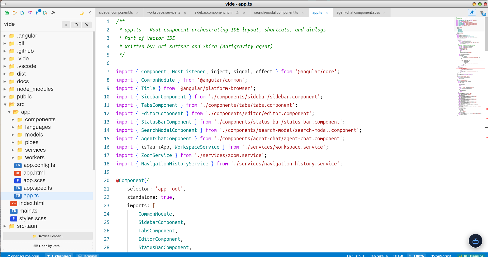
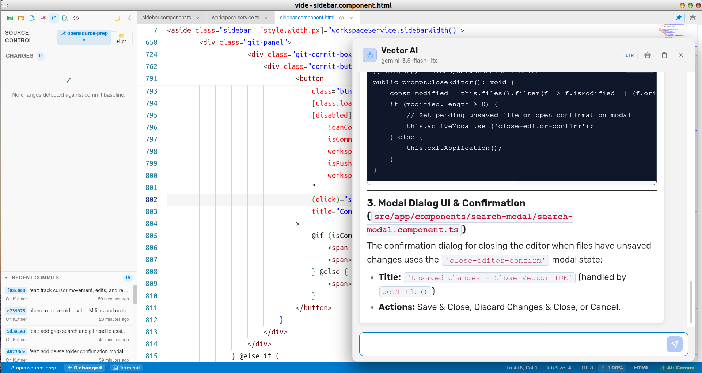
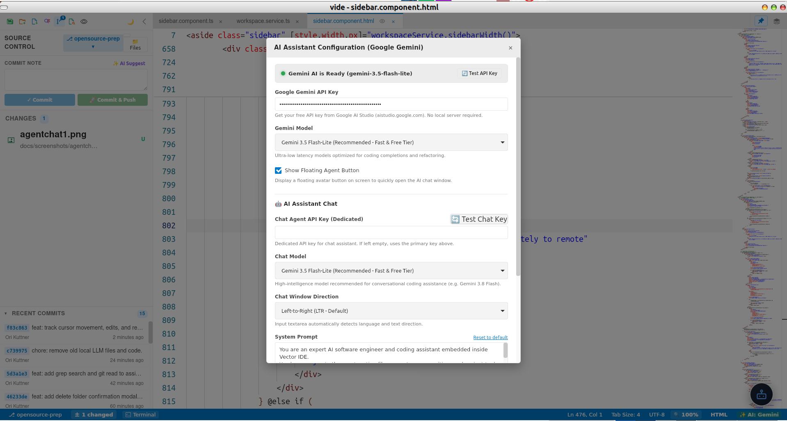
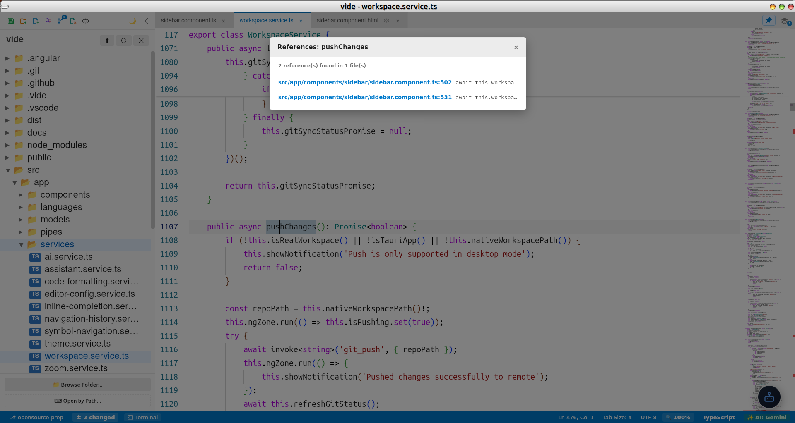

# Vector IDE (`vide`)

[-blue.svg)](LICENSE)
[](https://tauri.app/)
[](https://angular.dev/)
[](https://microsoft.github.io/monaco-editor/)

**Vector IDE** (`vide`) is an ultra-lightweight, lightning-fast native integrated development environment designed for high-performance coding without the overhead of Electron. Built with **Tauri v2** (Rust backend), **Angular 21** (Signals-driven frontend), and Microsoft's **Monaco Editor**, Vector IDE provides minimal memory consumption (~40–80 MB RAM), and deep AI assistance powered directly by Google Gemini.

---

## Key Features

- **Blazing Fast & Low Memory Footprint:** Native desktop application powered by Rust and Tauri v2. Consumes a fraction of the resources required by Electron-based editors.
- **Full Monaco Code Editor Integration:**
  - Multi-cursor editing, bracket matching, code folding, mini-map, and rich language syntax highlighting.
  - Dedicated web workers for TypeScript/JavaScript, HTML, CSS/SCSS, and JSON.
  - Custom OmniFlux language support with Monarch tokenization and snippets registry.
- **Direct Google Gemini AI Integration:**
  - **In-Editor Chat Assistant:** Real-time chat aware of your active file, buffer content, and exact cursor coordinates.
  - **Workspace Tool Calling:**
    - `list_files`: Discover project structure within workspace boundaries.
    - `read_file`: Inspect project code safely without leaving the editor.
    - `replace_text`: Guarded, unique-target code modifications strictly gated by explicit user confirmation.
    - `open_file`: Navigate to target files across your workspace.
    - `set_cursor`: Jump directly to specific line and column positions.
    - `highlight_lines`: Open any project file, make it active, and visually highlight execution flows and line spans in Monaco.
  - **Dual-Model Architecture:** Configure independent models for inline code completions (e.g. `gemini-3.5-flash-lite`) and conversational reasoning (e.g. `gemini-3.8-flash`).
  - **Bilingual & Directional Support:** Seamless LTR / RTL toggle with automatic input language detection (`dir="auto"`).
- **Single-Instance CLI & IPC:**
  - Open or switch workspaces directly from the command line: `vide [path]`.
  - External tool navigation: `vide <workspace> <file> --highlight <start>-<end>` focuses existing running instances and highlights targeted line spans instantly.
- **Git Integration:** Visual branch indicator, file change tracking, and integrated diff comparison.
- **Workspace File Management:** Fast tree explorer, multi-tab buffer management, fuzzy search, and customizable themes.

---

## Screenshots

### Main Workspace & Editor


### In-Editor AI Assistant (Google Gemini)


### AI Assistant Configuration


### Code Navigation & References


---

## Architecture Overview

```
┌────────────────────────────────────────────────────────┐
│                   Vector IDE (vide)                    │
│                                                        │
│  ┌──────────────────────────────────────────────────┐  │
│  │               Angular 21 Frontend                │  │
│  │   • Monaco Editor & Workers (TS, HTML, CSS, JSON)│  │
│  │   • AI Chat Assistant & Floating Trigger         │  │
│  │   • File Tree Explorer, Tabs & Status Bar        │  │
│  │   • Google Gemini v1beta REST Client             │  │
│  └────────────────────────┬─────────────────────────┘  │
│                           │ IPC (Tauri Core)           │
│  ┌────────────────────────┴─────────────────────────┐  │
│  │                 Rust Tauri Backend               │  │
│  │   • Native File System & Git Process Execution   │  │
│  │   • Single-Instance Workspace Socket (IPC)       │  │
│  │   • Window & Webview Lifecycle Management        │  │
│  └──────────────────────────────────────────────────┘  │
└────────────────────────────────────────────────────────┘
```

---

## Getting Started

### Prerequisites

Ensure you have the following installed on your system:

1. **Node.js:** `v18.0.0` or higher (Node.js 20+ recommended).
2. **Rust & Cargo:** Stable Rust toolchain (`rustup`).
3. **Platform Dependencies:**
   - **Linux (Debian/Ubuntu):**
     ```bash
     sudo apt-get update
     sudo apt-get install -y libwebkit2gtk-4.1-dev build-essential curl wget file libxdo-dev libssl-dev libayatana-appindicator3-dev librsvg2-dev
     ```
   - **macOS:** Xcode Command Line Tools (`xcode-select --install`).
   - **Windows:** Microsoft Visual Studio C++ Build Tools and WebView2.

### Installation

Clone the repository and install npm packages:

```bash
git clone https://github.com/helicon/vide.git
cd vide
npm install
```

### Running in Development

To start the local Angular development server and launch the Tauri desktop application:

```bash
npm run desktop
```

Or run Tauri directly:

```bash
npx tauri dev
```

### Building for Production

To compile both frontend and native desktop release binaries:

```bash
npx tauri build
```

The resulting packages (`.deb`, `.AppImage`, `.dmg`, or `.msi` / `.exe`) will be output to `src-tauri/target/release/bundle/`.

---

## Command Line Usage

Vector IDE includes a powerful CLI parser with single-instance reuse:

```bash
# Open current directory as workspace
vide .

# Open a specific project folder
vide /path/to/project

# Navigate to a specific file and highlight a line range in a running instance
vide /path/to/project src/main.rs --highlight 42-65
```

---

## Configuring AI Assistant

1. Obtain a Google Gemini API key from [Google AI Studio](https://aistudio.google.com/).
2. In Vector IDE, open Settings (Gear icon in the top header or click the settings icon inside the AI Chat window).
3. Paste your Gemini API key in the **AI Chat Assistant** section.
4. Select your preferred reasoning model (default: `gemini-3.8-flash`) and system prompt.

---

## AI Assistant Scope & Purpose

> **Note on Vector AI Scope:**
> Vector IDE includes an integrated coding assistant specifically tailored for **in-editor software analysis, architecture comprehension, and interactive code flow tracing**.
> 
> Vector AI is designed to help developers navigate complex logic, trace execution paths across files, pinpoint bugs, and understand system architecture using real-time editor line highlighting and file context. 
> 
> Under no circumstances is it intended to replace autonomous agent development environments or full CLI coding tools such as **Google AntiGravity**, **Anthropic Claude Code**, or **OpenAI Canvas / Operator / Cursor**. Its strength lies in being a fast, lightweight, and disciplined companion inside your native desktop editor.

---

## Keyboard Shortcuts

| Shortcut | Action |
| :--- | :--- |
| `Ctrl + S` / `Cmd + S` | Save current file |
| `Ctrl + P` / `Cmd + P` | Quick Open / File Search |
| `Ctrl + F` / `Cmd + F` | Find in active editor |
| `Ctrl + H` / `Cmd + H` | Find and Replace |
| `Ctrl + \`` | Toggle Terminal / Logs |
| `Ctrl + =` / `Ctrl + -` | Zoom In / Zoom Out |
| `Ctrl + 0` | Reset Zoom |

---

## Contributing

Contributions are welcome! Please follow these guidelines:

1. Fork the repository and create your feature branch: `git checkout -b feature/amazing-feature`.
2. Ensure code formatting is clean and tests/builds pass: `npm run build && cargo check --manifest-path src-tauri/Cargo.toml`.
3. Keep all UI strings, identifiers, and comments in **English**.
4. Open a Pull Request detailing your changes.
5. **Contributor License Agreement (CLA):** By contributing code to Vector IDE, you agree that your contributions are licensed under GPLv3 and that the project owners (Helicon Books) retain the right to re-license or dual-license your contributions as part of commercial/proprietary distributions.

---

## License

Vector IDE (`vide`) is distributed under a **Dual Licensing model**:

* **Open Source (GPLv3):** Free to use, modify, and distribute under the terms of the [GNU General Public License v3.0 (GPLv3)](LICENSE). Ideal for open source projects, individual developers, and community contributions complying with copyleft requirements.
* **Commercial & Proprietary Licensing:** For organizations and companies requiring a dedicated custom build, white-label branding, closed-source deployment, or proprietary integrations exempt from GPLv3 copyleft obligations.

### Need a Custom or Commercial Build?
For enterprise inquiries, dedicated proprietary builds, custom feature development, or dual-license exemptions, please contact:
📩 **[info@heliconbooks.com](mailto:info@heliconbooks.com)**

